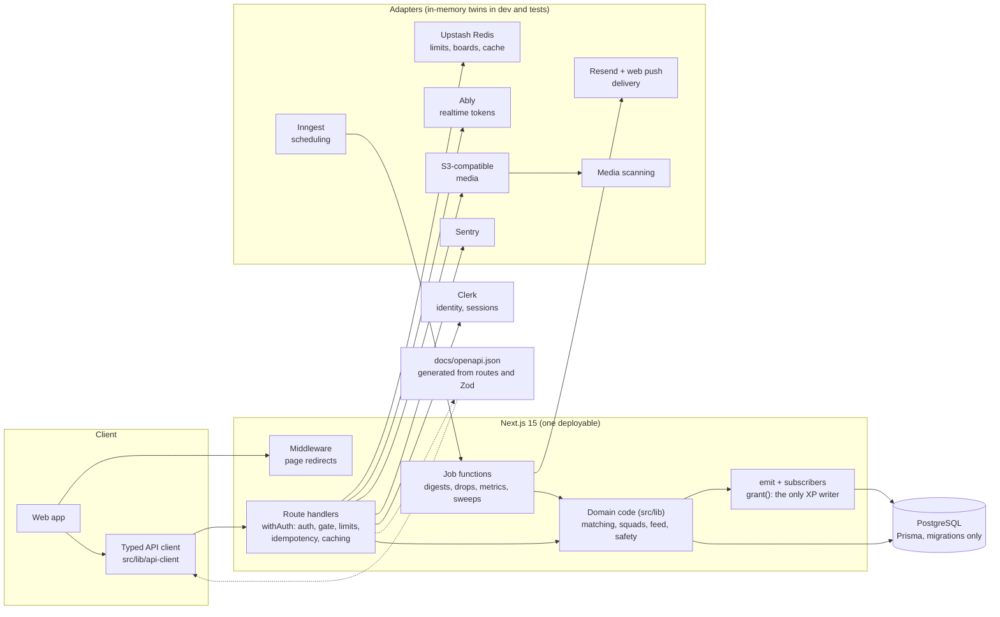

# Skill Dating

**A social network for people who build.** Find the right people to build with (a co-founder, a hackathon teammate, a collaborator, a mentor), matched on what they have
shipped instead of what their profile claims, then do the whole journey in one place: team up, build, ship, and earn a reputation that is made of proof.

> **Status: pre-launch.** The backend is complete and tested end to end; the interface is being designed separately and talks to the API through a generated, typed client.
> The private romance mode ("Halves") is built and **ships closed**; see [Halves](#halves-the-romance-mode-ships-closed).

## What makes it different

- **Proof, not profiles.** A passport of skills backed by evidence (projects, links, endorsements from verified peers), a Ship Feed of what people actually made, and XP that is only paid for real actions.
- **Matching that explains itself.** A handful of daily drops with the reasons they were chosen, a spark that needs a real opener (no "hey"), and one match leading to a conversation, not a swipe pile.
- **Squads for hackathons.** A squad builder that proposes a balanced team (roles, skills, time zones), a solo pool that auto-forms teams before the deadline, a looking-for-group board, pledges, peer reviews and a reliability signal.
- **Built to be trusted.** Age policy (16+, minors get a narrower product), reporting and appeals, content safety, consent records, data export and deletion, and a kill switch for every risky feature.

## Feature map

| Area | What it does | Docs |
| --- | --- | --- |
| **Passport** | Skills with levels, evidence and endorsements, current build, achievements, streak, live rank, cosmetics, a share card | [GAMIFICATION](docs/GAMIFICATION.md), [PRIVACY](docs/PRIVACY.md) |
| **Drops & Sparks** | Daily and weekly matching drops for five professional connection types, scored on skills, goals and rhythm; sparks with opener rules; matches with a conversation | [MATCHING](docs/MATCHING.md) |
| **Squads** | Hackathons (native and from other platforms), squad builder, solo pool, LFG board, team space (pledges, ideas, checklist), peer reviews | [SQUADS](docs/SQUADS.md) |
| **Crews & projects** | Teams with applications and invitations, projects with milestones and updates, "what I am building now" | [API](docs/API.md) |
| **Ship Feed** | Posts (ship, update, devlog, demo), Props, comments, follows, a ranked feed per city and campus, Ship Day every Friday | [FEED](docs/FEED.md) |
| **Progress** | XP and levels, quests (daily and weekly), 40 achievements, seasons, leaderboards by place and crew | [GAMIFICATION](docs/GAMIFICATION.md) |
| **Search** | One command-palette search over people, projects, crews, hackathons and posts, with typo tolerance | [SEARCH](docs/SEARCH.md) |
| **Reach** | Email and web push with a channel policy, quiet hours, digests, one-click unsubscribe; share cards; invites; verified campus chapters | [NOTIFICATIONS](docs/NOTIFICATIONS.md), [INVITES](docs/INVITES.md) |
| **Safety & privacy** | Reports, moderation queue, appeals, blocks and mutes, consent, export, delete, age policy, fraud signals | [SAFETY](docs/SAFETY.md), [PRIVACY](docs/PRIVACY.md), [SECURITY](docs/SECURITY.md) |
| **Admin** | Queue, people, flags and kill switches, audit log, metrics with one definition per number | [METRICS](docs/METRICS.md) |
| **Halves** | The opt-in private romance mode, **closed at launch** | [ROMANCE](docs/ROMANCE.md) |

### Halves, the romance mode (ships closed)

Built, tested and switched off. Until an operator opens it for a city every romance route answers `503 ROMANCE_PAUSED` and nothing about it appears in onboarding, search, notifications or the contract.
Adults can ask to be told when it opens (`POST /api/romance/interest`); the admin metrics show the interest by city. How and when to open it: [Turning on Halves](docs/LAUNCH_CHECKLIST.md#turning-on-halves-post-launch).

## Architecture



Everything outside Postgres sits behind an interface with an in-memory twin, so the whole product runs on a laptop with three settings and the test suite needs no third-party account but Clerk's development instance.
How the parts fit and why: [ARCHITECTURE](docs/ARCHITECTURE.md).

## Stack

Next.js 15 (App Router) · React 19 · TypeScript · PostgreSQL 16 · Prisma 5 · Clerk · Zod · Vitest · Tailwind CSS · Radix UI · React Query · react-three-fiber

## Local setup in five commands

Requirements: Node 20+ and PostgreSQL 13 or newer running locally, and a [Clerk](https://clerk.com) **development** instance (free).

```bash
git clone https://github.com/apexxx01/skill-dating.git && cd skill-dating
npm install
cp .env.example .env.local        # then set DATABASE_URL and the two Clerk keys (NEXT_PUBLIC_CLERK_PUBLISHABLE_KEY, CLERK_SECRET_KEY)
npm run db:migrate:deploy         # builds the schema from prisma/migrations
npm run seed:demo -- --username you && npm run dev
```

Open http://localhost:3000. `seed:demo` builds a small world of builders (a few minutes the first time), then adds a polished account named `you`: a passport with proof, a 45-day streak,
a squad before a hackathon deadline with one seat open, matches and drops. To sign in as it, run `npm run db:seed:clerk` once (it creates the Clerk accounts for the demo domain only; password `DemoPass123!`),
or simply sign up. A bigger world, a reset, and a 10,000-person benchmark world: [docs/SEED.md](docs/SEED.md). The seed refuses to run in production.

Every setting is documented in `.env.example`; the ones that matter in a deployment are under [Configuration](#configuration). Upstash, Inngest, Ably, Resend, push and storage are optional locally.

## Scripts

| Command | What it does |
| --- | --- |
| `npm run dev` / `build` / `start` | Develop, build and run the app |
| `npm run typecheck` / `lint` | Type-check; lint (CI blocks on the backend directories) |
| `npm test` | Unit tests: fast, no database, no network |
| `npm run test:integration` | The full integration suite: a production build, a disposable Postgres, real HTTP and real Clerk development sessions (about half an hour) |
| `npm run seed` | Build the seeded world: about 400 builders in 12 cities; `-- --scale 10000`, `-- --reset`, `-- --with-romance` ([SEED](docs/SEED.md)) |
| `npm run seed:demo -- --username <name>` | Add one polished demo account (refuses to run in production) |
| `npm run db:seed:clerk` | Create the Clerk users for the demo domain so those accounts can sign in (development keys only) |
| `npm run db:migrate` / `db:migrate:deploy` / `db:migrate:status` | Create a migration (development); apply pending migrations (CI and production); show what is applied |
| `npm run db:baseline` | One-off for a database created with the old `db push`: record the baseline as applied |
| `npm run db:studio` | Browse the database in Prisma Studio |
| `npm run openapi:scan` / `openapi:build` / `openapi:client` | Regenerate the route table, `docs/openapi.json` and the typed client; `openapi:check` fails if any is stale (CI runs it) |
| `npm run perf:measure` / `perf:load` / `perf:digests` / `perf:drops` | Measure the hottest endpoints at 10,000 people, drive them with autocannon (also against a preview), time the digests and the daily drops ([PERFORMANCE](docs/PERFORMANCE.md)) |
| `npm run postdeploy` | After every deploy: a season is running, leaderboards rebuilt, earned cosmetics granted, production dependencies present |
| `npm run sim:progression`, `bench:matching` | Simulate how long XP levels take; benchmark the matching engine |

## Documentation

| Read | For |
| --- | --- |
| [FRONTEND_CONTRACT](docs/FRONTEND_CONTRACT.md) | **Start here to build a page**: one section per page, with endpoints, types, realtime, states and the moments to celebrate |
| [openapi.json](docs/openapi.json) | The machine-readable API (OpenAPI 3.1), generated from the routes; the typed client is `src/lib/api-client` |
| [API](docs/API.md) | Every route: auth, limits, bodies, responses and errors |
| [ARCHITECTURE](docs/ARCHITECTURE.md) | How the backend is put together, and why |
| [DEPLOY](docs/DEPLOY.md), [LAUNCH_CHECKLIST](docs/LAUNCH_CHECKLIST.md) | Deploying, the flags, and everything that must be true before a public launch |
| [PERFORMANCE](docs/PERFORMANCE.md), [SEED](docs/SEED.md) | Measurements at 10,000 users with before and after; the seeded world |
| [SECURITY](docs/SECURITY.md), [PRIVACY](docs/PRIVACY.md), [SAFETY](docs/SAFETY.md) | Threat model and controls; what is collected and for how long; age policy, reports and moderation |
| [MATCHING](docs/MATCHING.md), [SQUADS](docs/SQUADS.md), [FEED](docs/FEED.md), [GAMIFICATION](docs/GAMIFICATION.md), [SEARCH](docs/SEARCH.md), [NOTIFICATIONS](docs/NOTIFICATIONS.md), [INVITES](docs/INVITES.md), [METRICS](docs/METRICS.md), [ROMANCE](docs/ROMANCE.md) | One document per feature area |
| [AUTH_MIGRATION](docs/AUTH_MIGRATION.md) | How authentication moved to Clerk |
| [CHANGELOG](CHANGELOG.md), [PRODUCT](PRODUCT.md) | What arrived stage by stage; the product vision |

## Configuration

| Variable | Required | Purpose |
| --- | --- | --- |
| `DATABASE_URL` | yes | PostgreSQL connection string (PostgreSQL 13 or newer). |
| `NEXT_PUBLIC_CLERK_PUBLISHABLE_KEY`, `CLERK_SECRET_KEY` | yes | From the Clerk dashboard. Use a development (`pk_test_` / `sk_test_`) instance while developing; the integration suite refuses any other key. |
| `CLERK_WEBHOOK_SECRET` | in production | The signing secret of the webhook endpoint that points at `/api/webhooks/clerk`. Without it the route answers `503` and processes nothing. |
| `CLERK_AUTHORIZED_PARTIES` | set it in production | Comma separated origins allowed to mint session tokens (for example `https://app.example.com`). Unset skips the authorized-party check. |
| `TRUSTED_PROXY_HOPS` | set it when deploying | Number of reverse proxies you run in front of the app. `0` (the default) means the client address is unknown, so **all signed-out callers share one rate-limit bucket**. Behind a single load balancer set `1`. Details below. |
| `UPSTASH_REDIS_REST_URL`, `UPSTASH_REDIS_REST_TOKEN` | in production | Upstash Redis (REST). Holds rate-limit counters, leaderboards, presence. Set both or neither. |
| `INNGEST_EVENT_KEY`, `INNGEST_SIGNING_KEY` | in production | Inngest, for background jobs (served at `/api/inngest`). Set both or neither. |
| `ABLY_API_KEY` | in production | Ably (`appId.keyId:secret`), for realtime. Used only on the server; browsers get tokens from `POST /api/realtime/token`. |
| `APP_URL` | with email | Where the app is served, no trailing slash: the absolute links in emails and share cards. |
| `RESEND_API_KEY`, `EMAIL_FROM`, `RESEND_WEBHOOK_SECRET` | to send real mail (not enforced at boot) | Email through Resend, and the webhook that marks bounced and complained addresses undeliverable. Without them an in-memory outbox keeps what would have been sent. |
| `NOTIFICATION_SIGNING_SECRET` | where mail is real | 32+ random characters; signs the unsubscribe links. Without it a key is derived from `CLERK_SECRET_KEY`, so rotating that breaks links in mail already sent. |
| `VAPID_PUBLIC_KEY`, `VAPID_PRIVATE_KEY`, `VAPID_SUBJECT` | to send real pushes (not enforced at boot) | Web push. Without them pushes are recorded and not sent. |
| `STORAGE_*` (endpoint, bucket, region, access key, secret; optional public base URL) | to accept uploads (not enforced at boot) | S3-compatible object storage. Set together; without them production refuses uploads with `503 STORAGE_UNAVAILABLE`. |
| `MEDIA_MODERATION_URL`, `MEDIA_MODERATION_TOKEN` | to accept avatars and romance photos | The media scanning provider. Without one, production refuses those uploads (fail closed); development treats everything as safe. |
| `SENTRY_DSN` (and the build-time `SENTRY_ORG`, `SENTRY_PROJECT`, `SENTRY_AUTH_TOKEN`) | recommended | Error reporting with personal data scrubbed. Without a DSN nothing is sent. |
| `POSTHOG_KEY`, `POSTHOG_HOST` | optional | Forward product events to PostHog (they are always stored in the database). |
| `BIRTH_DATE_REQUIRED`, `ENTITLEMENTS_ENFORCED`, `LOG_LEVEL` | optional | Age gate in onboarding (default on); plan limits (default off); log level. |

The **romance mode is not a setting**: it is the database flag `romance.enabled` (plus a flag per city), created **off** by a migration and changed only by an administrator (`/api/admin/flags`), so no environment can turn it on by accident.

Sign-in providers (Google, GitHub, and so on) are configured in the Clerk dashboard, not here.

### Validation

Every setting is checked by `src/lib/env.ts` when the server starts. A missing or malformed one
stops it (in production the process exits with code 1), with all the problems listed by name
(never by value). Empty values count as unset.
`next build` needs only `NEXT_PUBLIC_CLERK_PUBLISHABLE_KEY` (public, and inlined into the browser bundle, so a deployment build needs the real one). In development and tests the Redis, Inngest and Ably settings are
optional: an in-memory stand-in is used, which keeps state per process and delivers nothing
outside it. In production they are required, because those stand-ins cannot work across instances.

"Production" means `VERCEL_ENV=production`, or `NODE_ENV=production` where `VERCEL_ENV` is not set
(self-hosting stays strict). A Vercel **preview** deployment also runs with `NODE_ENV=production`;
with `VERCEL_ENV=preview` it may start without the "in production" settings above, on the in-memory
stand-ins, and prints a startup warning naming each one it is running without. Settings that are
present are still validated, and credential pairs must still be set together.
Code reads settings through the typed `env` object, never `process.env`. See
[`docs/ARCHITECTURE.md`](docs/ARCHITECTURE.md).

## Rate limiting and proxies

Limits are keyed on the signed-in user. Signed-out traffic needs the client's
address, and a client address can only be trusted when a proxy you
control writes it. So the address is read from `X-Forwarded-For` only when you say how
many proxies sit in front of the app:

| `TRUSTED_PROXY_HOPS` | Behaviour |
| --- | --- |
| `0` (default) | Forwarding headers are ignored. Signed-out callers share one generously sized bucket. Right for local development. |
| `1` | One reverse proxy or load balancer in front. The address the proxy appended (the rightmost entry) is used. |
| `N` | N trusted proxies; the Nth entry from the right is used. |

Never set it higher than the number of proxies you actually run: anything to the left
of the trusted entries can be forged by the client. Counters live in the shared cache
(`src/lib/infra/cache.ts`): Upstash Redis when configured, so the limit is exact across
instances, and process memory otherwise, where each instance keeps its own count.

## Database migrations

The schema changes through Prisma migrations only. `prisma db push` is not used (there is
no script for it) because it changes a database without leaving a record that can be
reviewed, replayed or rolled forward elsewhere.

- **New database:** `npm run db:migrate:deploy`.
- **Changing the schema:** edit `prisma/schema.prisma`, run `npm run db:migrate` and give
  the migration a descriptive name, read the generated SQL, and commit the schema change and
  the migration directory together. CI fails a pull request whose schema differs from what
  the migrations produce.
- **A database that already exists** (created earlier with `prisma db push`): it already has
  the baseline schema, so do not run the baseline SQL against it. Run `npm run db:baseline`
  once to record `20261014000000_baseline` as applied, then `npm run db:migrate:deploy` for
  anything newer. `npm run db:migrate:status` should then report the database is up to date.
- **Rolling back** is a new forward migration; Prisma does not generate down migrations.

`20261014000000_baseline` was generated with
`prisma migrate diff --from-empty --to-schema-datamodel prisma/schema.prisma --script`. Applied
to an empty database it produces exactly the schema `db push` produced.

## Project layout

```
prisma/schema.prisma     data model          prisma/migrations/   SQL migrations; the only way the schema changes
prisma/seed.ts, seed/    the seeded world    prisma/seed-demo.ts  the polished demo account
scripts/openapi/         route scan, spec and client generators      scripts/perf/   measurement and load scripts
src/app/api/             route handlers (a schema.ts beside each holds its request schemas)
src/lib/                 domain code: matching, squads, feed, rewards, safety, notify, search, openapi
src/lib/api/             withAuth, the error catalogue, the request gate, idempotency and HTTP caching
src/lib/api-client/      the typed client (generated.ts is generated; runtime.ts is hand-written)
src/lib/infra/           cache, jobs, realtime behind interfaces, with in-memory twins
src/lib/env.ts          validated, typed environment (the only reader of process.env)
src/types/api.ts         response types shared with the interface
tests/integration/       real-server, real-database tests
docs/                    the documents above
```

## Continuous integration

`.github/workflows/ci.yml` runs on every push and pull request: type-check, backend lint (blocking) and whole-repository lint (report only), a production build, unit tests, a check that
`prisma/schema.prisma` and the migrations agree, and a check that `docs/openapi.json` and the typed client are up to date. `.github/workflows/integration.yml` runs the full integration suite
against a Postgres 16 service container and a production build on pull requests to `main` and every night. Workflows hold placeholders only; the integration run needs the keys of a Clerk
**development** instance as repository secrets (`CLERK_SECRET_KEY`, `NEXT_PUBLIC_CLERK_PUBLISHABLE_KEY`) and is skipped with a warning where they are not available (forks).

## Roadmap

Backend: Phase 1 is complete with Stage 1H. Before a public launch, see [LAUNCH_CHECKLIST](docs/LAUNCH_CHECKLIST.md): real providers smoke-tested, legal reviews, backups tested.

- **The interface.** The full design, built against the typed client and the page contract. Sentry's global error boundary belongs to that phase.
- **Realtime events beyond matches.** The channels for conversations and squads are authorised but nothing publishes there yet; the interface refetches instead.
- **Halves.** Opened city by city after launch, once the interest, the media scanning, the legal review and the moderation capacity are there.
- **Not planned yet:** challenges (they need sandboxed code execution, a security decision), project stars and forks, presence and typing indicators, team logos.

See [PRODUCT.md](PRODUCT.md) for the product vision and principles.
