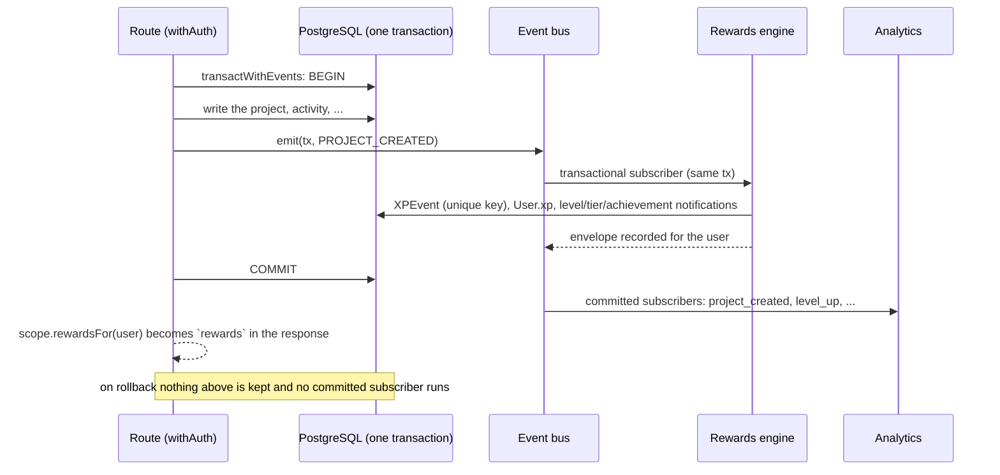

# Architecture

How the backend is put together, and why. For routes and bodies see [`API.md`](API.md), for
setup see the [README](../README.md), for how authentication was moved to Clerk see
[`AUTH_MIGRATION.md`](AUTH_MIGRATION.md).

## Shape of the system

```
Browser ──► Next.js 15 (App Router, one deployable)
              ├─ src/middleware.ts        page redirects only (not a security boundary)
              ├─ src/app/api/**           route handlers, each wrapped in withAuth
              ├─ src/lib/                 domain logic, auth, env, errors, rate limiting, events, rewards
              └─ src/lib/infra/           swappable providers behind interfaces
                    ├─ cache      Upstash Redis   counters, rate limits, sorted sets, presence
                    ├─ jobs       Inngest         background work, served at /api/inngest
                    └─ realtime   Ably            server publish, per-user subscribe tokens
            PostgreSQL (Prisma)   system of record, changed only by migrations
            Clerk                 identity and sessions
```

One process type serves everything. State that must be shared between instances lives in
PostgreSQL or Redis, never in process memory.

## A request, start to finish

1. **Middleware** (`src/middleware.ts`, Clerk) redirects signed-out visitors away from
   app pages and signed-in ones away from sign-in, and asks `/api/users/me` whether onboarding is
   done. That answer is `complete`, `incomplete` or `unknown` (`src/lib/onboarding-state.ts`): only
   a definite `incomplete` sends anyone to `/onboarding`, and a `401` or any other failure is
   `unknown`, which lets the request through to the page's own `auth()` check. It exists for navigation. **It is not
   trusted for security**: a client could once make middleware be skipped
   (CVE-2025-29927, fixed in Next 14.2.25 and 15.2.3; this repo runs 15.5.27), and API routes are
   not matched by it at all.
2. **`withAuth`** (`src/lib/api/handler.ts`) wraps every API handler. It calls `authenticate`
   (`src/lib/session.ts`), which takes the bearer token or the `__session` cookie, verifies
   signature, expiry and authorized party against Clerk's keys, and resolves the **local**
   `User` row, creating or linking it on first sight. Anonymous callers are rate limited
   before getting a `401`.
3. The per-route **rate limit** and **role check** run, then the handler. Handlers get
   `{ user, prisma }` and return through `createApiResponse` / `createApiError`.
4. Server components call `auth()` (`src/lib/auth.ts`), which runs the same verification.

`tests/integration/middleware-bypass.test.ts` walks every page and API route and sends
`x-middleware-subrequest` in both spellings. It requires an anonymous caller to be refused exactly
as without the header. Against Next 14.1.0 it failed (an anonymous visitor was served
`/onboarding`); it passes on 14.2.35 and on 15.5.27.

## Environment (`src/lib/env.ts`)

`process.env` is read in one place. A Zod schema validates every setting the app uses and
exposes it as a typed `env` object.

- **Fail fast.** `src/instrumentation.ts` validates when the server starts and every problem is
  listed in one pass, by name and never by value. In production the process then **exits with
  code 1** (`src/lib/boot.ts`): `next start` on its own only logs an error from this hook and keeps
  listening, answering every request with a 500, which a supervisor would take for a healthy
  process. In development the error is thrown instead, so the dev server stays up for a fixed
  `.env.local`. `next build` does not run it, so builds and CI need no secrets; they need only the public Clerk
  publishable key, which the root layout's `ClerkProvider` reads while pages are prerendered. Fonts
  are self-hosted (`src/app/fonts`, `next/font/local`, SIL Open Font License texts included), so a
  build needs no network access for them.
- **Empty means unset**, so a copied `.env.example` parses.
- **Production is stricter.** The webhook secret and the Redis, Inngest and Ably credentials
  are required, because the in-memory stand-ins would give each instance its own rate limits
  and presence, and would run no real jobs or realtime delivery. Each credential pair must be
  set together. Production means `VERCEL_ENV=production`, or `NODE_ENV=production` when
  `VERCEL_ENV` is unset (`requiresProductionConfig`). A Vercel preview runs with
  `NODE_ENV=production` as well, so `VERCEL_ENV=preview` is what lets it boot on the in-memory
  stand-ins: `src/lib/boot.ts` then prints a warning naming every service it is running without
  (`inMemoryFallbacks`), and the stand-in job queue runs jobs in-process. The services, and what
  each stand-in loses, are listed once in `SERVICES` in `env.ts`, which both the production
  requirement and the warning read.
- Module-scope code that cannot wait for the whole configuration uses `nodeEnv`, which parses
  `NODE_ENV` alone.
- Tests that change `process.env` call `resetEnvCache()`. Unit tests get dummy values for the
  required settings from `vitest.config.ts`.

## Database and migrations

PostgreSQL through Prisma. The schema changes only through migrations in `prisma/migrations`;
there is no `db push` script. `20261014000000_baseline` was generated from the schema as it stood
(`prisma migrate diff --from-empty`) and is marked applied on databases that already had it
(`npm run db:baseline`). CI replays all migrations into an empty database and fails when the result
differs from `schema.prisma`. The integration suite drops and rebuilds its own database from the
migrations on every run, so it exercises what production runs. The workflow is in the README.

## Infrastructure adapters (`src/lib/infra/`)

Each capability is an interface with a production implementation and an in-memory one. Callers
import the interface and a getter (`getCache()`, `getJobQueue()`, `getRealtime()`); the factory
picks the implementation from configuration. Swapping a provider means writing one class that
implements the interface and changing one factory. Nothing else moves.

| | Interface | Production | In-memory | Chosen when |
| --- | --- | --- | --- | --- |
| Cache | `Cache` in `cache.ts` | `RedisCache` over Upstash REST | `MemoryCache` (`cache.memory.ts`) | `UPSTASH_REDIS_REST_URL` and `_TOKEN` set |
| Jobs | `JobQueue` in `jobs.ts` | `InngestJobQueue` | `MemoryJobQueue` (`jobs.memory.ts`) | `INNGEST_EVENT_KEY` and `_SIGNING_KEY` set |
| Realtime | `Realtime` in `realtime.ts` | `AblyRealtime` | `MemoryRealtime` (`realtime.memory.ts`) | `ABLY_API_KEY` set |

Each getter is process-wide and survives dev-server reloads; `setCache`, `setJobQueue` and
`setRealtime` replace it in tests.

### Cache

Strings with optional expiry, counters, fixed windows, and sorted sets (`zadd`, `zincr`, `ztop`,
`zrevrank`, range by score). Three operations exist for leaderboards: `zincrMany` (many increments in
one round trip, a pipeline on Redis, with an expiry that is started and never pushed back), `zreplace`
(rebuild a board under a scratch key and swap it in with one rename, so nobody sees a half-built board),
`zstage` (the same, for a board that is built in pieces and corrected while it is built: `set`, `remove`, then
`commit` or `discard`) and `expire`. `createPresence` and `createLeaderboard` are built on those. The two
operations that must not race, `incr` and `hit`, are single atomic operations: one Lua script on
Redis that increments, starts the expiry if the key has none, and reports the time left. A key can
therefore never outlive its window. The Redis client runs with automatic deserialization off so a
member that looks like a number stays a string. The in-memory cache keeps the safety properties of
the limiter it replaced: expired entries are swept and the key count is hard-capped, so
fabricated keys cannot grow memory.

**Rate limiting** (`src/lib/rate-limiter.ts`) is `CacheRateLimiter` on `hit`. The `RateLimiter`
interface, `consumeSafely` (fails open by default, closed on request) and every caller are unchanged.
Client addresses are trusted only as far as `TRUSTED_PROXY_HOPS` says (README, "Rate limiting").

### Jobs

`jobs` in `jobs.ts` is the registry: each job has a name (`area/action`, also the Inngest event
name), a Zod payload schema, a retry count and a handler. Payloads are validated when enqueued and
again when run. `inngestFunctions()` turns the registry into Inngest functions, and
`/api/inngest` serves them; the handlers are built on first use, so a build needs no credentials.
`MemoryJobQueue` validates, drops repeated ids and retries like the real queue, and runs on
`drain()` in tests or automatically in development. It is not durable.

A job may declare a `schedule` (a UTC cron expression): Inngest then triggers it on that schedule as
well as on its event. The in-process queue never schedules; any job can be run right away with
`POST /api/admin/jobs/{name}` (admin only, audited), which is also how a deployment without Inngest runs
them. Handlers import their module lazily, so the registry stays light.

| Job | Schedule | Module |
| --- | --- | --- |
| `system/ping` | none | checks a new environment's Inngest credentials end to end |
| `seasons/rollover` | hourly | `src/lib/seasons.ts`: close the finished season, write its standings, open the next |
| `achievements/rarity` | 03:30 daily | `src/lib/achievement-rarity.ts` |
| `leaderboards/reconcile` | 04:00 daily | `src/lib/leaderboard-rebuild.ts`: rebuild every current board from the XP log: aggregate up to a cutoff, replay what came after, swap |
| `leaderboards/refresh-user` | event | move one person's entries after a place or privacy change |
| `cosmetics/backfill` | event, once | `src/lib/cosmetics.ts`: grandfather cosmetics for existing users |
| `drops/generate` | hourly (:05) | `src/lib/matching/drops.ts`: daily drops for everyone whose chosen local time has passed |
| `drops/expire` | hourly (:20) | `src/lib/matching/drops.ts`: mark unanswered drops past their day EXPIRED |
| `drops/second-look` | Mondays 07:15 | `src/lib/matching/second-look.ts`: one grown, previously passed candidate per person per week |

To add a job, add an entry to `jobs`, enqueue it with `getJobQueue().enqueue(name, data)`, and
test the handler through `runJob` or a `MemoryJobQueue`.

### Realtime

The server publishes; browsers only subscribe. `POST /api/realtime/token` returns a signed,
subscribe-only token request bound to the caller, covering only channels they may read (own
`user:<id>`; `conversation:<id>` and `team:<id>` for members). One refused channel refuses the
request. Channel access is the pure function `authorizeChannels`, built on the existing membership
checks. The API key never leaves the server. **No code publishes yet**: the adapter and the
subscription path are in place, and wiring publishes into messaging and notifications is the next
step.

## Domain events and rewards

Anything that should react to something a user did (pay XP, count it, tell someone) listens to
a **domain event** instead of being called from the route. `src/lib/events.ts` is a typed
in-process bus. A route that changes something calls `emit(tx, 'PROJECT_CREATED', payload)`
**inside its database transaction**, opened with `transactWithEvents()` instead of
`prisma.$transaction()` so the bus knows when it ends. Two kinds of subscriber exist:

- **transactional** subscribers run inside `emit()`, on the same transaction. Anything that must
  commit or roll back together with the action belongs here: the rewards engine is one, so XP
  is never paid for an action that rolled back, and a failing reward rolls the action back;
- **committed** subscribers run after the commit, and never for a rollback. A throwing committed
  subscriber is logged and swallowed, since the request already succeeded. Analytics lives here.

**Handlers stay light; heavy work goes to Jobs.** A transactional subscriber holds the request's
database transaction open, so it may only do database work that has to commit with the action
(write a row, pay XP, create a notification). Anything slow or that talks to another service
(email, webhooks, recounts, fan-out to many users) is enqueued as a [Job](#jobs) instead, and a
committed subscriber is the place to enqueue it, since a job must not start for an action that
rolled back. To make a runaway handler fail rather than hold a connection, every transaction
opened with `transactWithEvents()` has an explicit **15 second timeout**
(`EVENT_TRANSACTION_TIMEOUT_MS` in `src/lib/events.ts`; Prisma's default would be 5). A caller
can pass its own `timeout`, but a longer one is a sign the work belongs in a Job. A unit test
fails if a file that emits an event does not open its transaction with `transactWithEvents()`.

`src/lib/subscribers.ts` registers both and is loaded by the bus before the first event. The
bus is one per process (kept on `globalThis`): Next can evaluate a module once per route bundle,
and separate copies would each have their own subscribers and their own record of open
transactions.



Events today: `PROJECT_CREATED`, `PROJECT_SHIPPED`, `PROJECT_UPDATE_POSTED`, `MILESTONE_COMPLETED`,
`HACKATHON_JOINED`, `HACKATHON_WON`, `TEAM_FORMED`, `TEAM_APPLICATION_ACCEPTED`, `EVIDENCE_ADDED`,
`EVIDENCE_ENDORSED`, `CONNECTION_ACCEPTED`, `MESSAGE_SENT_FIRST_IN_CONNECTION`, `MESSAGE_REPLIED`, and four
that the rewards engine announces itself: `STREAK_EXTENDED`, `USER_COMEBACK`, `ACHIEVEMENT_UNLOCKED`,
`TIER_REACHED`. A new event is one entry
in `DomainEvents`, one in `DOMAIN_EVENT_NAMES` and one in `EVENT_REWARDS`
(`src/lib/rewards-config.ts`), which a unit test keeps in step. Emit it from the route inside
its transaction; nothing else needs to change.

### Rewards engine

`src/lib/rewards.ts` (`grant()`) is the **only** code that writes an `XPEvent` or changes `User.xp`.
What an event pays is data, in `src/lib/rewards-config.ts`: amount, daily cap and the one-time key
per action. The rules, the level curve, the tiers and the response envelope are in
[GAMIFICATION.md](GAMIFICATION.md). Three properties come from the design:

- **Exactly once.** Each award has a `dedupeKey` (`project:<id>`, `achievement:<slug>`, `milestone:<id>`, ...) and a
  unique index on `XPEvent (userId, type, dedupeKey)`. Two racing requests cannot both insert; the
  loser sees nothing was written and pays nothing. No lock is needed for this.
- **Capped per local day.** Capped actions take a transaction advisory lock per user and action,
  then count awards since the user's local midnight (`src/lib/time.ts`, `User.timezone`, UTC if
  unset). Parallel requests line up on the lock, so none slips under the cap.
- **One reported total.** `User.xp` moves by one atomic `UPDATE ... RETURNING`, and the
  `RewardsEnvelope` is computed from the before and after totals by pure functions, so level and
  tier changes in it cannot disagree with `levelFor()`.

Existing rows were migrated safely: the dedupe columns are nullable, achievement rows were back-filled with
their key, and every other legacy row keeps a null key, which the unique index treats as distinct
(`20261015000000_xp_event_dedupe`).

### Progress: streaks, achievements, quests, cosmetics

`grant()` does more than pay. In the same transaction it stamps the award with the active season
(`XPEvent.seasonId`), moves the user's streak when the award is an action of their own (`src/lib/streaks.ts`;
the `User` row is locked by the same `UPDATE ... RETURNING` that adds the XP, so concurrent awards cannot
tear a streak), and announces `STREAK_EXTENDED`, `USER_COMEBACK` and `TIER_REACHED`. After the commit it
retires the user's cached views and adds the award to the Redis leaderboards (`src/lib/xp-views.ts`);
a failure there is logged and the nightly rebuild repairs it.

The subscriber for every event (`payForEvent`, `src/lib/subscribers.ts`) then counts what happened.
`src/lib/metrics.ts` turns an event into **ticks** ("this user shipped this project"), but only for an award
that actually paid, so the daily caps and the gates limit achievements and quests exactly as they limit XP.
`recordTick()` inserts the tick (a unique key makes it count once) and raises a counter
(`ProgressTick`, `UserCounter`); `src/lib/achievement-progress.ts` unlocks the achievements the counter
reaches through `grantAchievement()` and `src/lib/quest-progress.ts` moves the user's current quests. Everything
that touches one user's progress takes an advisory lock for that user first, in id order for events that
involve two people, so concurrent requests serialise and cannot deadlock. Cosmetics are earned by
`TIER_REACHED`, `ACHIEVEMENT_UNLOCKED` and `STREAK_EXTENDED` through `src/lib/cosmetics.ts`, the only code that
writes the inventory. Quests can be paused with the `quests` feature flag.

Which three daily and three weekly quests a person has is not stored: it is a seeded shuffle of the pool by
`(user, period)` (`src/lib/quests.ts`), so there is no midnight job and no state to get out of step.

## Matching

The matching engine (profile, compatibility score, daily drops, sparks, matches) is described in [MATCHING.md](MATCHING.md). It follows the
platform patterns: the pure scorer is in `src/lib/matching/score.ts`; the hourly jobs `drops/generate` and `drops/expire` are in the job
registry; a spark that completes a pair writes the match, its conversation and its notifications in one `transactWithEvents`
transaction under a per-pair advisory lock and announces `MATCH_CREATED`, which pays no XP and only counts toward three achievements;
realtime pushes (`match.created`, `match.ended` on the `user:{id}` channel) and analytics (`drop_viewed`, `spark_sent`, `match_created`,
`unmatch`) happen after the commit. The platform's own conversation lines (a match's icebreaker) are sent by a tombstone-style system
account (`src/lib/matching/system-user.ts`) that every list leaves out because it is marked deleted.

## Entitlements and feature flags

`src/lib/entitlements.ts` holds one table of what each plan (`FREE`, `PRO`, `CREW_PRO`, `ORG`) gets:
counted limits (`DAILY_DROPS`, `DAILY_SPARKS`, `BUILD_DATES_PER_WEEK`) and switches (`SEE_WHO_SPARKED`,
`ADVANCED_FILTERS`, `PROFILE_ANALYTICS`, `CUSTOM_DOMAIN`). Code asks `can(subject, feature)` or
`limit(subject, feature)`, never for a plan name. The plan comes from the user's `Subscription` row
(`subjectFor`): none, expired, or lapsed means `FREE`. A paywall is therefore a config change:

- `ENTITLEMENTS_ENFORCED=false` (default) opens every switch to everyone and lifts counted limits to
  their **hard safety ceiling** (`hardLimit`, an abuse bound that applies to every plan, enforced or not);
- `ENTITLEMENTS_ENFORCED=true` applies the limits of the user's plan.

Nothing consumes `can()` or `limit()` yet; the first caller arrives with the features they guard.
`Subscription.provider` and `providerRef` are reserved for billing and unused.

`src/lib/flags.ts` evaluates runtime flags stored in `FeatureFlag`: a user is in when they are on
the allowlist (even while the flag is off), or the flag is enabled and a hash of the flag key and user
id falls under `rolloutPercent`. The hash is stable, so raising the percentage only adds users. The flag
set is cached for 30 seconds in the Cache adapter and dropped on every admin change (on Redis that
reaches every instance). Admins manage flags under `/api/admin/flags`; every user reads their own
answers from `GET /api/flags`.

## Analytics

`src/lib/infra/analytics.ts` follows the adapter pattern: `track(userId, event, props)` always writes
a `ProductEvent` row (so the numbers exist with no third party) and, with `POSTHOG_KEY` set, also
forwards the event to PostHog. Events: `signup`, `onboarding_completed`, `project_created`,
`project_shipped`, `level_up`, `tier_up`, `achievement_earned`, `quest_completed`, `streak_extended`. Tracking happens after the
transaction commits, never fails the request, and carries no personal data: the user is our
internal id, and props are reduced to plain values under safe names (names, emails, free text and
URLs are dropped whoever passes them). `signup` counts a brand-new account only, not the linking of an old
row; `onboarding_completed` is recorded once, the first time the profile has a headline and a skill.

## API conventions

All of these are built into `withAuth` (`src/lib/api/handler.ts`), so a route gets them by being a
route:

- **Request id.** One per request (a plausible incoming `X-Request-Id` is kept), returned in the
  `X-Request-Id` header and attached to every log line written while the request runs, through
  `AsyncLocalStorage`. The wrapper also writes one access line per request (method, path without query,
  status, duration, user id) and turns an unexpected exception into a logged `500 INTERNAL_ERROR`.
- **Logging** (`src/lib/log.ts`) is JSON lines. Fields whose name looks sensitive are replaced before
  anything is written; the rule for callers is still "ids, never names, emails or message text".
  With `SENTRY_DSN` set, error-level logs are also sent to Sentry through its envelope endpoint over `fetch`
  (no SDK); `setErrorReporter()` swaps in an SDK later.
- **Pagination** (`src/lib/api/pagination.ts`): `paginate()` for lists ordered by a stored column
  (keyset cursors: the sort value and id of the last row, so a page costs the same at any depth and
  paging is not shifted by new rows), `paginateOffset()` and offset cursors where the order is computed
  or spans columns. Page-numbered requests still work and now also return `nextCursor`.
- **Idempotency** (`src/lib/api/idempotency.ts`): `withAuth(handler, { idempotent: true })` on
  creating POST routes. **Every new creating `POST` must opt in** (one that creates a row, a
  message, a request or an award), because a client that retries after a timeout must not create it
  twice. Today that is 18 routes: the 17 user-facing creating routes listed in [API.md](API.md#platform)
  and `POST /api/admin/flags`. The POSTs that do not opt in change existing state or are unique by
  construction rather than create something: marking a conversation read, submitting for a
  hackathon, transferring a team, endorsing (one per endorser and evidence), the reaction toggle
  (a retried toggle undoes itself, so a client must not retry it blindly), the realtime token and the
  Inngest endpoint. The stored response lives 24 hours in the Cache adapter; an atomic counter
  decides which of several simultaneous requests runs. See [API.md](API.md#platform).
- **Health.** `GET /api/health` is public and reports database, cache, jobs and realtime. Only a
  database failure answers 503.

## Error contract

Every API error is `{ error: { code, message } }`, plus `params` and `details` when present. Codes
are enumerated in `src/lib/api/errors.ts` with an HTTP status and an English default message
using `{placeholders}`, which keeps them translatable: a client renders its own text from
`code` and `params`. Routes call `createApiError('TEAM_FULL')`; the code is a TypeScript union, so
an unknown code does not compile. A unit test fails if any route builds an error body by hand, and
another if `docs/API.md` does not list every code. Codes are only added, never repurposed.

## Testing

| Suite | Command | Needs |
| --- | --- | --- |
| Unit | `npm test` | nothing; Prisma and providers are mocked or in-memory |
| Integration | `npm run test:integration` | PostgreSQL and a Clerk **development** secret key |
| Typecheck, lint | `npm run typecheck`, `npm run lint` | nothing |

Integration tests run against a real `next dev` server and a real database rebuilt from
migrations, with real Clerk users and sessions. The server runs the in-memory infrastructure, so
those tests check policy and wiring, not the providers. `TEST_SERVER_LOG=<file>` keeps the server's
output when a run fails. One contract suite (`cache.contract.ts`) defines how every `Cache` must
behave and runs against both implementations.

**What is not verified against the real service.** The Upstash adapter is tested through a fake
Redis client, which proves command mapping, key prefixing and reply parsing but not Redis semantics
(including that Lua script). The Inngest adapter is tested against a recording sender, not Inngest
Cloud. The Ably adapter's token signing is tested against the real SDK offline, but publishing is
not. Run each against a real instance before depending on it.

`/api/inngest` is the Inngest SDK's own handler. Without keys (development, tests) it runs in the
SDK's dev mode: `GET` describes the functions, an unsigned `POST` is refused with `401`, and `PUT`
(registration) answers `500` because it tries to reach a local Inngest dev server that is not
running. That `500` is the SDK's behaviour, not a fault in the route. That an unsigned request is
rejected when `INNGEST_SIGNING_KEY` is set has not been exercised, since it needs a real key.

Run against `next dev`, the integration suite can hit a race inside Next itself: several first
requests to dynamic-segment routes at once make the dev server read a manifest file while another
compile is writing it, giving a `500` from inside `next/dist` before any application code runs, or a brief `404` for a
page that exists (`SyntaxError: Unexpected end of data` in the server log). A single such failure in a
full run is a flake, and re-running clears it. The
bypass test therefore requests each route once, one at a time, before sending anything in parallel.
`next start` uses prebuilt manifests and is not affected.

## Deploying

The order of a deploy (migrate, deploy, `npm run postdeploy`) and the post-deploy command are in [`DEPLOY.md`](DEPLOY.md).

## Continuous integration

Type-check, backend lint (blocking), whole-repo lint (report only), production build, unit tests,
a migrations check (replay the migrations into an empty database and diff against the schema),
and the integration suite against a Postgres service container.

## Known limitations and open items

- Nothing publishes realtime events.
- Leaderboard boards are copies of the XP log in Redis. They are repaired nightly, so a failure to update one
  can show a stale score for up to a day. XP that arrives during a rebuild is counted exactly once (see
  [GAMIFICATION.md](GAMIFICATION.md#leaderboards)); an award committing between the last replay pass and the
  rename is put back by a final pass after the swap; what remains is an award committing after that pass has read the log,
  which costs it until the next run. The rebuild aggregates in SQL and holds one batch of 5,000 people in
  memory, but it still scans each period's slice of the `XPEvent` table (indexed by time and by season) every night;
  at tens of millions of rows an incremental version is the next step.
- Raw SQL that compares a bound `Date` with a `DateTime` column goes through `utcTimestamp()` (`src/lib/sql.ts`); written
  without it the comparison is read in the database's time zone, which is only right when that zone is UTC. Every raw query
  that binds a date uses it (leaderboards, heatmap, rarity, counters). Beyond that, every database session runs in UTC, in three
  layers: the application's connections ask for it with the `options=-c timezone=UTC` connection parameter
  (`src/lib/database-url.ts`, skipped for a URL with `pgbouncer=true`, since poolers refuse startup options); the
  migration `utc_database_default` sets the database's own default to UTC (this also covers pooled connections); and
  the queries convert explicitly. `tests/integration/session-timezone.test.ts` runs the heatmap, the rarity job and the counters on
  sessions in five zones and requires identical answers.
- `ProgressTick` gets a row per counted action. Once an action has paid, its XP award is what stops it counting
  twice, so ticks older than a couple of weeks are only history (the week-based secret achievements look back at most
  seven days); pruning them is not built.
- Migrations and counters use `gen_random_uuid()`, which is built into PostgreSQL 13 and later.
- A season is closed by an hourly job, so it can run past its end by up to an hour; a closed season's cosmetics are granted by the same job (and by `npm run postdeploy`), and a season that could not be granted is retried every hour.
- A blocked person is left out of a viewer's leaderboard but keeps their rank, so a rank is the same number on every
  leaderboard and on the player card; a viewer's page can skip ranks.
- `npm audit --omit=dev` still reports Next's bundled PostCSS (fixable only by Next 16); see
  [Dependency advisories](#dependency-advisories).
- Dependencies are installed with `--legacy-peer-deps` when they change: `inngest` has an optional
  SvelteKit peer that needs Vite 8 (the test runner uses Vite 5), and `@react-three/fiber` 9 lists
  `react-native` and `expo` as optional peers, a mobile-only chain npm cannot resolve here. A plain
  `npm ci` accepts the resulting lockfile, and `npm ls` reports no invalid peer range.

## Dependency advisories

`npm audit --omit=dev` on Next 15.5.27 and React 19.3: **2 findings (1 high, 1 moderate), 0 critical.**
Moving from Next 14.2.35 to 15.5.27 cleared every advisory against Next itself (including the
Server Components and request-handling ones the 14.x line could not fix) and the `braces` /
`tailwindcss` chain that used to be reported through `tailwindcss-animate`. Earlier fixes stand:
`@clerk/nextjs` 6.39.7, `glob` pinned to 10.5.0 on the Inngest tracing path through an `overrides`
entry, `source-map-js` updated. The image optimizer is also off (`images.unoptimized`; `/_next/image`
answers 404), since no code uses `next/image`.

| Finding | Why it remains | Exposure |
| --- | --- | --- |
| `postcss` 8.4.31 bundled inside `next` (high: stringify XSS and three source-map read issues) | Next ships its own copy; the audit's only fix is Next 16.4.0, a major upgrade | Build time only. It processes this repository's own stylesheets, never request input, so there is no attacker-controlled CSS or source-map comment to exploit. |
| `next` (moderate) | Reported only because it depends on that PostCSS; none of Next's own advisories apply to 15.5.27 | Same as above. |

Across the whole tree, including dev dependencies, `npm audit` reports 17 findings (2 critical:
`vitest` and its `tinypool`; the rest `vite`, `esbuild`, `tailwindcss` and its `braces` /
`micromatch` / `fast-glob` / `chokidar` chain, `eslint-config-next`). All are development tools that
never run in the deployed server: the test runner, the dev server's bundler and the CSS generator.
They are upgraded with their own major versions (Vitest 3 or later, Tailwind 4), not here.
